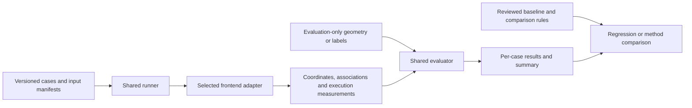

# Feature frontend regression and comparison

**Status:** Draft design. The independent pair scorer and a first C++ ORB dataset
pipeline are implemented and tested on CPU and RTX 3060 CUDA. Additional frontend
adapters, qualified comparison profiles and reviewed regression baselines remain pending.

This proposal refines [B-01](../roadmap.md#b-01-per-module-unit-benchmarks) for
image frontends. [Verification policy](../spec/verification.md) owns evidence
acceptance; [dataset qualification](offline-datasets.md) owns input/reference
identity and held-out splits. It does not select a new production frontend.

## Two uses, one evaluation protocol

| Use | Question | Comparison boundary |
|---|---|---|
| Regression | Did an identified change degrade the same frontend? | Compare with a reviewed baseline; declare the changed source, model or setting and hold other relevant bindings fixed. |
| Method comparison | Which frontend offers suitable quality at an acceptable cost? | Same task, inputs, coordinate domain, output budget and evaluator; retain each method's declared configuration. |

The compared unit is a complete recipe: detector/descriptor or direct tracker,
matcher, selection and geometry policy, execution backend, and configuration.
For example, changing an ORB matcher is different from changing only CPU to CUDA.
Do not compare one extractor's time with another method's complete tracking time.
Method comparison produces quality/cost tradeoffs, not a universal scalar score
or an automatic replacement of another method's regression baseline.

## Shared harness and adapter boundary



Use one runner and thin adapters to actual production entry points. No rewritten
benchmark-only detector/matcher, separate evaluator per algorithm, or new generic
estimator interface is needed. Adapter capabilities distinguish extraction,
description, matching and temporal tracking. A fused implementation may expose
only complete-pipeline timing; do not invent internal timings to fill columns.

| Boundary | Shared representation |
|---|---|
| Input | Ordered images/pairs, image/time/camera identity, masks, coordinate/calibration binding and reset schedule. |
| Observations | Finite pixel coordinates and frame identity, with persistent track IDs only for temporal tracking. Return resize/padding/undistortion mappings explicitly. |
| Pair associations | Indices or IDs of corresponding observations, with one-to-one acceptance status. Raw scores are optional and method-specific. |
| Descriptors | Optional opaque payload plus encoding, dimension, distance metric and recipe identity. Hamming, L2 and learned matching are not forced into one encoding. |
| Execution | Status, named timing boundaries, actual candidate/output counts and measured resource use. |

KLT can participate in tracking tests without supplying descriptors. A descriptor
method can participate in pair tests without claiming persistent tracks. A
nonapplicable capability is `N/A`; failure or missing evidence for a required
capability is not. Ground truth is visible only to the evaluator, except for
explicitly labelled component fixtures such as fixed supplied keypoints.

## Workloads and truth

| Case family | What is known | What it can evaluate |
|---|---|---|
| Known image warps | Fixed source images, transformation, masks and photometric perturbations | Detector repeatability, pixel transfer error and pair association under known geometry. Fix seeds and image hashes. |
| Calibrated nonplanar sequences | Synthetic image formation, poses, depth/occlusion and landmark identities | Essential-geometry rejection, temporal identity and track survival. A planar homography test alone cannot qualify the production epipolar filter. |
| HPatches image sequences | Published reference homographies, with illumination/viewpoint changes | An additional real-image detector/pair-matching comparison. Full-image evaluation differs from the cropped-patch descriptor protocol. |
| EuRoC camera sequences | Real flight images, calibration and trajectory reference | End-to-end feature continuity, failure rate, coverage and runtime. Trajectory truth alone supplies no per-feature depth or correspondence labels. |

Use the first two families for independent accuracy labels; use EuRoC for realistic
operation. Report geometry-based homography labels as such, not as manually
annotated physical identities. For EuRoC, reference-pose epipolar residuals can
provide consistency evidence after time/calibration qualification, but cannot
certify every match. Do not report per-feature RMSE without a valid correspondence
reference, or trajectory ATE/RPE before an estimator exists.

Separate tuning and held-out cases. Fixed keypoint/descriptor fixtures isolate a
component; complete-image tests measure the interaction with detection. A method
that cannot consume a component fixture remains eligible for suitable pipeline
tests. Future relocalization needs separate map/query and negative-place cases;
temporal tracking scores do not establish loop recognition performance.

## Metrics and denominators

| Scope | Quality/correctness | Cost |
|---|---|---|
| Detection and spatial selection | Repeatability, actual retained count, occupied fraction of a fixed evaluation grid over the valid image region | Extraction/selection latency and memory |
| Description and matching | Correct accepted pairs, precision, detection-conditioned recall and pixel transfer error | Description and matching latency; actual query/train sizes |
| Geometric rejection | True-match retention and false-match acceptance against independent labels | Verification latency and failed-model count |
| Temporal tracking | Correct-track survival at fixed horizons, identity switches, fragmentation and frames with insufficient usable tracks | Complete per-frame latency, failures and deadline misses |
| Complete estimator, later | Qualified trajectory accuracy/coverage and recovery | Estimator plus frontend latency/resource use |

For a homography case, evaluate in its declared common pixel domain. With
`w_H(p)` the reference warp, eligible pairs satisfy
`norm(p_target - w_H(p_source)) <= epsilon_px` and visibility in both images.
Freeze the tolerance grid in the protocol before comparison. Values such as
1, 3 and 5 pixels are candidate reporting thresholds, not flight acceptance bounds.

Let N1 and N2 count evaluated detections in the common valid region. Let G be the
maximum number of one-to-one geometric pairs under that criterion. Let M count
accepted unique predicted pairs and C the correct ones. Report:

- Repeatability = G / min(N1, N2).
- Precision = C / M; detection-conditioned recall = C / G.
- Pixel transfer RMSE = sqrt(sum of squared transfer errors / evaluated pair count).
  State the evaluated set: report correct-pair error and all eligible accepted-pair
  error separately, together with C and M. Never hide bad pairs by publishing only
  the correct-pair RMSE. Predictions outside the eligible domain remain invalid
  outputs or false associations; exclusion cannot improve the precision score.

Geometric assignment and tie handling belong to the shared evaluator, independent
of descriptor scores or RANSAC results. Duplicate or out-of-range pair indices
are invariant failures, not silently removed before scoring. Detection-conditioned recall does not
measure missing scene features, so retain repeatability, feature counts and
coverage alongside it. Synthetic identity labels use their own explicit visibility
and horizon denominators. Without those labels, EuRoC track length measures
continuity, not proven correct tracking. Zero denominators produce `N/A` with raw
counts; required nonempty coverage and successful-frame obligations remain checked.

Report every selected frame, rejection, timeout and failed run. Give per-sequence
metrics before a declared aggregate; long/easy sequences must not silently dominate
the summary. Empty or aborted runs cannot pass because their surviving frames
have low latency or low error.

## Fair timing and resource comparison

Freeze image domain/resolution, workload, feature publication budget and sequence
order. Initially use a common maximum of 400 published observations, matching the
current development profile; record actual counts and all internal budgets. A
later budget sweep can compare quality/cost curves. Each method retains its native
settings under a named profile; equal FAST/ratio thresholds are not meaningful
across unrelated algorithms. Tune on development data only.

Measure component calls and the complete production pipeline separately. Report
median, P95, P99 and maximum observed latency in milliseconds, sample counts,
warmup policy and repeated-run variation. Cold initialization/model loading is
reported separately. For flight-style comparison use sequential, batch-one input
with persistent method state and the same reset schedule. Batched offline
throughput is a separate workload.

Host latency ends when the result is usable by its consumer. GPU timing therefore
includes required transfers, synchronization and conversion; device events may
add a separately labelled kernel/stream measurement. Do not sum independently
measured stages as a substitute for end-to-end timing. Keep disk decoding,
evaluation, visualization and report I/O outside frontend timing; report image
acquisition/preprocessing cost separately and include it in a separately measured
integration latency where applicable.

Record CPU/GPU model, compiler/dependencies, precision, threading, power/clock mode,
thermal/load conditions and allocator warm state. Measure host/device memory
separately with a declared tool/boundary; unavailable measurements are not zero.
Deadline misses use a predeclared budget; measured maximum is not WCET. Timing
regression decisions require a sufficiently controlled host and a reviewed
variation policy. Shared CI timing is informative, not an automatic performance gate.

CPU and CUDA now use aligned [descriptor-smoothing settings](orb-frontend-settings.md);
the benchmark records the actual device and rejects mismatched adapter settings.
Keep the current CPU build's disabled SIMD/IPP profile distinct from any optimized
CPU deployment profile.
RTX 3060 and Orin need independent timing/resource baselines. Identical detections,
descriptor bytes and track IDs across implementations are not a comparison premise.

## Regression records and decisions

Keep a versioned case inventory: stable case ID, task/capabilities, input and
reference hashes, evaluator/protocol revision, applicable requirements, execution
profile and required metrics. Bind runs to source revision plus dirty-content
identity, complete resolved configuration, dependencies and model-weight hashes.
For learned methods, record training provenance and known evaluation-data overlap;
unknown provenance is an explicit qualification limit.
Execution IDs identify results; semantic case IDs must survive source refactors.

A baseline binds those identities, reviewed summary metrics and comparison rules.
Never compare against whichever output directory was written most recently.
Changes to workload, evaluator, coordinate domain or incompatible profiles produce
`NOT_COMPARABLE`, not a regression verdict. Different algorithms can be compared
under a shared task without being comparable as unchanged-algorithm regression.

| Result | Meaning |
|---|---|
| PASS | Required cases and reviewed quality/resource rules are satisfied. |
| FAIL | A required invariant/case or an established acceptance limit failed. |
| INCONCLUSIVE | Required evidence, acceptance limits or reliable timing are missing. |
| NOT_COMPARABLE | Identities/protocols do not support the requested comparison. |

Report candidate-minus-baseline changes with units, denominators and direction.
Use percentage points for rates and ratios for latency only when valid. Set
metric-specific absolute/relative tolerances and timing variation rules before
acceptance runs. Do not assume a universal 5% allowance or let faster execution
cancel degraded correctness. Unexpected nondeterminism is measured; repeated-run
sampling and reproducibility claims belong to the declared execution profile.

Freeze a baseline only after review. An expected algorithm change can request a
new baseline with a comparison and rationale; failures never auto-update it.
Version control holds manifests, protocols, comparison rules and explicitly
reviewed compact baselines. Datasets, raw timings, plots and trial logs stay in
ignored directories; selected release evidence follows the existing policy.

## Implementation order and traceability

1. Establish the independent pair scorer and validate it with known-answer
   coordinate fixtures, including correct, false, duplicate, empty and missing
   outputs. This scorer is implemented and shared by the workloads below.
2. Exercise actual frontend calls through one runner, using fixed inputs and
   recording quality, failures and execution cost. The initial ORB pipeline now
   runs real EuRoC frames plus known translations. Per-stage timings and process
   high-water RSS are available. Controlled CPU/CUDA comparisons, GPU allocation
   and target-resource qualification remain open.
3. Compatible-report deltas and identity checks are implemented. Add reviewed
   acceptance limits and explicit regression decisions. Qualify a second algorithm
   and optional HPatches cases
   with the same scorer and held-out evaluation.

Initial mappings use [V-ORB](../spec/requirements/vision/orb-frontend.md),
[V-EXECUTION](../spec/requirements/vision/frontend-execution.md),
[V-OBSERVATION](../spec/requirements/vision/observation-admission.md) and
[V-ACQUISITION](../spec/requirements/vision/acquisition.md). Benchmark cases expose
specific quality/resource evidence, not complete requirement or formal-proof
coverage. V-ORB remains ORB-specific: another production method needs reviewed
requirements, not an automatic claim that it satisfies V-ORB.

## Current implementation and tests

The [C++ benchmark](../../benchmark/features/orb_benchmark.cpp) reads a fixed EuRoC window
and calls the existing production `OrbTracker`. The [runner](../../benchmark/features/run_feature_benchmark.py)
invokes that executable, checks frame identities, scores its known-translation
outputs and writes per-case CSV plus JSON summaries and input/executable hashes.
Temporal tracking and known-translation testing run in separate native processes
from one explicit configuration snapshot. They retain independent results and
failure counts. A fixed CSV schema and last-published summary define the report
completion boundary; native execution success alone does not complete a report.
The [usage guide](../guides/frontend.md#fixed-dataset-orb-benchmark) owns runnable
commands, workload/timing boundaries and output descriptions. Both real adjacent
frames and synthetic pairs pass through the production geometry filter; inlier
membership is the prediction being evaluated, never the reference label.

The [suite entry](../../scripts/run_benchmark.py) runs CPU then CUDA using a shared
profile/executable, checks recorded input/build bindings, and archives combined
JSON plus readable metric tables in a fresh output directory. Results remain
unreviewed baseline candidates; reviewed tolerances and repeated-run qualification
remain pending. Compatible-report metric deltas are implemented; automatic
acceptance/replacement is not.

[feature_metrics.py](../../benchmark/features/feature_metrics.py) is a host-only Python
3.10+ module using the standard library. It has no detector, OpenCV or GPU
dependency and does not change the numerical core.

| Entry | Input and result |
|---|---|
| `score_pair` | Source coordinates already projected into the target pixel domain, target detections, independent eligibility flags, one-to-one predicted index pairs and a nonnegative inclusive pixel tolerance. Returns raw counts, repeatability, precision, detection-conditioned recall and separate all-eligible/correct-pair RMSE. |

The runner owns the scheduled-case inventory and success/failure/missing counts
for each workload. This accounting is separate from the mathematical pair scorer;
scoring or execution success does not establish quality acceptance.

Reference projections and eligibility are caller responsibilities; the module
does not compute homographies, visibility or physical landmark identities. Both
point arrays must contain finite coordinates, even for ineligible points. Transfer
error is the one-directional Euclidean distance in target pixels. Ineligible
predictions remain in the precision denominator but have no evaluated transfer
error. Undefined metrics return `None` (`null` in JSON). Invalid indices, duplicate
assignments, nonfinite data or unrepresentable distances raise `ValueError`.
Invalid native evidence fails the workload; its scheduled cases remain represented
without silently substituting zero error or omitting missing results.

[Known-answer fixtures](../../benchmark/features/tests/fixtures/feature_pairs.json) contain projected
coordinates and hand-calculated expected scores, not generated images or an ORB
baseline. The [unit tests](../../benchmark/features/tests/test_feature_metrics.py) also compare the
assignment algorithm against exhaustive assignments for all 3-by-3 bipartite
graphs, check threshold/empty/failure behavior and exercise RMSE scaling. These
tests validate the scorer; they do not measure frontend accuracy or performance.

Run from the repository root:

```bash
python3 -m unittest discover -s benchmark/features/tests -p test_feature_metrics.py -v
```

The [runner tests](../../benchmark/features/tests/test_feature_benchmark.py) check native-result
ingestion, missing/failed/reordered frames, reference-transform direction,
configuration snapshots and independent workload control. Filesystem-failure
tests check that failed CSV creation/replacement cannot publish a successful
summary. CTest can also run the actual fixed-dataset pipeline by
explicitly configuring its dataset path. Execution completion is distinct from
quality acceptance. Temporal lifecycle/censored lengths, grid occupancy, rejection
counts, per-stage timing and process high-water RSS are implemented. GPU allocation,
qualified target bounds and reviewed baseline decisions remain open; there is no
automatic regression PASS/FAIL decision.

## References

- [HPatches dataset and protocols](https://github.com/hpatches/hpatches-dataset):
  correspondence/homography evaluation under viewpoint and illumination changes.
  The project protocol above is an adaptation, not a claim of official benchmark
  score compatibility. Pin the acquired data and evaluator before use.
- [SuperPoint reference evaluation](https://github.com/rpautrat/SuperPoint/blob/master/README.md#results-on-hpatches):
  detector repeatability and geometry-based descriptor comparisons with declared
  feature budgets and pixel thresholds; not deployment thresholds for this project.
- [NVIDIA timing guidance](https://docs.nvidia.com/cuda/cuda-c-best-practices-guide/index.html#timing):
  distinguish asynchronous device work from completed host-visible latency.
