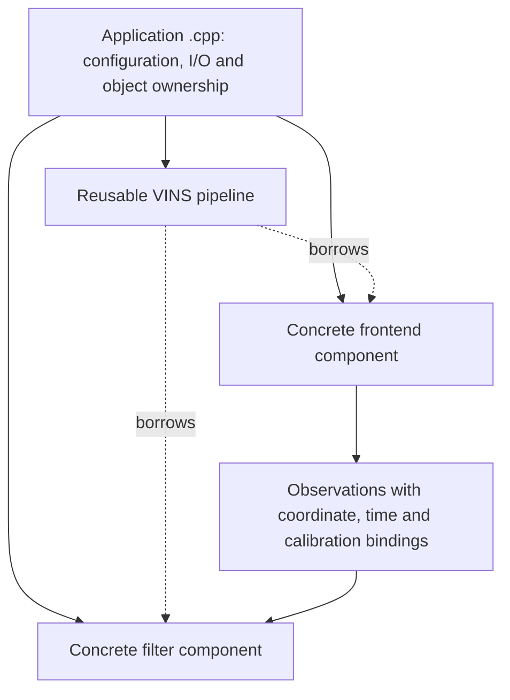

# Application and Component Composition

**Status:** Draft design for review; proposed types below are not implemented APIs.

## Scope and requirements

The application selects and owns components; reusable components provide the
processing behavior. [C-CPP-SUBSET](../requirements/common/cpp-subset.md#application-composition)
owns composition, template and source-organization rules. This architecture
applies them to the proposed local VINS, using
[M-LIFECYCLE](../requirements/msckf/lifecycle.md),
[V-TRACK](../requirements/vision/feature-tracks.md) and
[V-EXECUTION](../requirements/vision/frontend-execution.md) for execution/ownership.
[V-ORB](../requirements/vision/orb-frontend.md) owns the ORB feature-processing contract.

## Responsibilities and interfaces

| Part | Owned responsibility |
|---|---|
| Application | Select backend/precision/capacities and frontend type; construct components, load configuration, feed acquisition data and publish results. Keep deployment I/O here. |
| VINS pipeline | Connect the selected frontend and filter through direct named operations. Borrow their instances, preserve result semantics and translate only at the declared data boundary. This is a host composition layer when it invokes an image library. |
| Frontend | Own image-processing resources, descriptors and live tracking identities; publish observations under V-TRACK/V-EXECUTION. OpenCV/CUDA allocation and execution stay in this component. |
| Filter runtime | Own the joint estimate, FEJ state and local update lifecycle. Retain bounded observation histories separately from the joint filter state; own numerical workspace or explicitly borrow it. It consumes observation records, not images or descriptors. |
| Numerical components | Implement independently callable scalar/linalg/SO(3), propagation, camera geometry, triangulation and update mathematics using resolved types. |

The application constructs dependencies before a pipeline that borrows them and
keeps them alive until the pipeline has stopped using them. The filter runtime
is the owner of update ordering and transactions; the pipeline does not duplicate
its propagation/clone/correction logic. The blocking frontend completes its work
before observations are passed to the filter. An asynchronous queue/thread design
would require a separate execution contract.

## Template and file boundaries

An illustrative composition is `Vins<Filter, Frontend>`: Filter already binds its
linalg backend, scalar type and capacities; Frontend is a concrete tracking
component. The application establishes aliases and creates objects in `.cpp`.
These names illustrate a boundary, not permission to add placeholder classes.
A plain concrete class remains appropriate when no type variation is needed.

The frontend boundary produces observations with stable track identities. In the
current naming, that responsibility belongs to `OrbTracker`, which contains its
`OrbExtractor`. An extractor alone produces keypoints/descriptors and candidate
matches; it does not discharge the tracking contract. The pipeline does not take
a second extractor or duplicate the tracker's association logic.

FeatureTracker names the common `process`/`reset` contract in V-EXECUTION, not a
base class. `OrbTracker` is its first concrete implementation. The shared
`TrackedImage` contains only identity, pixel domain and observations; optional
`OrbTrackingDiagnostics` serves ORB inspection/benchmarks. Future descriptor or
optical-flow trackers implement the same observation contract with their own
options and state. A consumer does not need an extractor API or descriptors.

| Responsibility | Placement |
|---|---|
| Application entry and deployment wiring | Application/example `.cpp`, selecting and constructing library components. |
| Reusable typed VINS orchestration | Proposed `include/formal_gvins/vins.hpp`, with declarations followed by necessary template definitions. It belongs to host composition, not the image-independent numerical core. |
| ORB extraction, localization and descriptor operations | Existing `include/formal_gvins/vision/orb.hpp` declares the component; `src/vision/orb.cpp` contains non-template implementations and private helpers. |
| ORB matching, spatial selection and tracking | `include/formal_gvins/vision/orb_tracker.hpp` and `src/vision/orb_tracker.cpp`; extend the cohesive module before splitting private steps into separate files. Stereo remains proposed. |
| Shared tracker result/status | `include/formal_gvins/vision/tracker.hpp`; method-independent host batch, without OpenCV dependencies. |
| Observation records | `include/formal_gvins/vision/observation.hpp`; numeric identities/coordinates for bounded consumers, independent of image-library and dynamic containers. |
| Numerical state and lifecycle | `include/formal_gvins/msckf/`; state/math templates already exist. The complete filter runtime remains proposed. |
| Projection, inverse camera and triangulation | Existing `include/formal_gvins/msckf/camera.hpp` and proposed `include/formal_gvins/msckf/triangulation.hpp`; backend/capacity-dependent mathematics remains in headers. |

The ordinary frontend methods can be compiled into a static library even when
called from a templated VINS pipeline. Their declarations satisfy compilation;
the application links their compiled definitions. This arrangement does not
require virtual dispatch, a factory framework or header-only image processing.
The existing explicit CPU/CUDA option remains a frontend configuration decision.

Keep public interfaces readable before their implementation bodies. Use local
helpers for related steps rather than a separate component/template per ratio
test, geometry gate or refinement step. A new file or class needs a responsibility
or ownership boundary, not merely a new requirement ID.

## Verification and implementation boundary

The current [build](../../../CMakeLists.txt) has an INTERFACE numerical target,
separate backend targets, and STATIC frontend/dataset targets. The
[EuRoC example](../../../examples/euroc_frontend.cpp) assembles the current frontend;
it is not a complete VINS application. No `Vins` coordinator or complete filter
runtime is supplied by this specification.

Composition checks cover independent core builds, header self-containment,
multi-translation-unit linkage, borrowed lifetimes and the actual selected
component combination. Numerical evidence identifies backend/precision/capacity;
frontend evidence identifies algorithm/execution settings. Whole-pipeline tests
exercise timestamp/identity transfer, empty/rejected/failed results and lifecycle
transactions. A component proof does not automatically verify the application,
OpenCV/device internals or an untested template configuration.
