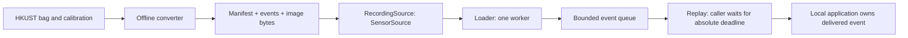

# Host Sensor Acquisition and Replay Architecture

**Status:** Draft

## Scope and requirements

[H-RECORDING](../requirements/host/sensor-recording.md) owns conversion and source
access; [H-PUBLISH](../requirements/host/sensor-publication.md) owns local pacing.
This layer makes recorded data available to an application. It does not implement
VINS assembly, GNSS fusion, camera clock alignment or estimator output prediction.

## Responsibilities and interfaces

| Component | Responsibility and interface |
|---|---|
| Existing `download_datasets.py` | Pinned HKUST download/support files, resume and full-file verification. No duplicate HKUST-only downloader. |
| `convert_hkust.py` | ROS-free offline bag decoding, complete topic payloads, lossless raw image storage and source/calibration identity. |
| `io::SensorSource` | Single-pass `next(event)`, first recording time and stream metadata. EOF differs from exception failure. No factory or numerical template parameter. |
| `dataset::RecordingSource` | Concrete streaming implementation; also exposes the complete manifest and embedded source schemas. |
| `io::SensorEvent` | Owns one typed measurement and optional source-specific provenance. Recording events retain all original fields for on-demand dataset access. |
| `io::Replay` | Borrows one source; preloads, captures t0, returns due owning events with timing metrics. |
| Application | Selects typed inputs, handles quality/time/calibration admission and forwards to its own consumers. Numerical APIs receive qualified measurements through an explicit application binding. |

`formal_gvins::io` owns the common types and replay worker, with no JSON, ROS,
OpenCV or Eigen dependency. The optional `formal_gvins::recording` target adds
nlohmann/json only at the dataset boundary. The source decodes known schemas once
into `event.measurement`; callers read that value directly. Common structs and
variant selection are host data representation, not numerical type dispatch.

`RecordingSource` retains each original event line in `source_record`, avoiding
a permanent JSON object beside its typed values. Its dataset-specific
`recording_fields(event)` accessor parses native payload fields on demand. This
preserves all raw-GNSS fields and exact integer timestamps without requiring
ordinary IMU/image/PVT consumers to parse again. Image bytes belong to the typed
image measurement. Other sources can provide typed data with no serialized
record; the common interface does not require ROS schema names or JSON encoding.

## Execution and state

The caller supplies source lifetime and replay options. `start()` fills the queue
(or reaches EOF) before defining simulated boot. `next()` moves one event out,
waits until its absolute deadline using `steady_clock`, and returns its ownership
to the caller. Source/format errors abort publication; stop wakes waits. Files
remain immutable for the lifetime of the source. Use a new source/replay to restart.

`publication_deadline(epoch, offset)` performs checked clock arithmetic without
reading a clock or waiting. Tests can exercise exact boundaries independently of
OS timing. The current host implementation explicitly requires a nanosecond
`steady_clock` duration, as provided by the Linux configurations tested here.

The default queue has 32 event slots, configurable from 1 through 4096. The queue
reserves slots once, moves owned payloads, and never executes parsing/file reads
under its mutex. A condition variable handles availability, capacity, stop and
failure; a second semaphore is unnecessary. The portable core RingBuffer is not
used for these allocating host payloads: its sample-copy contract is stricter.

Input record and image byte limits are 4 MiB and 16 MiB respectively. The loader
temporarily allocates JSON objects while parsing; slot count is not a byte-memory
budget. At most the queued events plus loader, publication and caller-owned
payloads are retained by this path. Caller retention and source implementations
need their own resource limits. Ordinary Linux scheduling and storage can delay
publication. Lateness is measured; a positive explicit budget can terminate the
session. The default reports lateness without dropping records. Timing CSV output
in the example also consumes caller time and can increase later delivery latency.

## Reference comparison and design decisions

| Inspected reference | Relevant practice | Local decision |
|---|---|---|
| [Basalt dataset interface][basalt] | Dataset implementation behind an ordinary interface, integer timestamps, image access separate from filter state. | Keep a concrete source and thin interface; stream all sensor kinds instead of loading every numeric sample into a dataset object. |
| [OpenVINS sensor data][openvins] | Explicit IMU/camera inputs and sensor identity separate from middleware messages. | Publish typed common observations; keep native schema decoding and full-field access at the dataset boundary. No ROS types in the core. |
| [ORB-SLAM3 EuRoC replay][orb] | Application-level dataset loop and pacing around image processing. | Use a single absolute boot mapping with separate loading so processing time does not redefine subsequent deadlines. |
| [Rosbags][rosbags] | Embedded bag schemas can be read without the ROS software stack. | Use only in the offline Python converter; the C++ reader needs no bag or ROS libraries. |

These are design comparisons, not imported source or a claim of identical
execution policies. The host layer is intentionally simpler than a complete
multi-threaded estimator or a generic publish/subscribe framework.

## HKUST binding and verification boundary

Use the pinned catalogue's `gvins/sports_field`. Conversion preserves the bag's
recorded arrival order and original timestamps, not a shared corrected clock.
PVT week/TOW, PPS flags and trigger messages remain accessible for subsequent
clock alignment. Ephemeris reference epochs never become replay deadlines.

The dataset identifies `/cam0/image_raw` as right and `/cam1/image_raw` as left;
message `frame_id` alone must not infer this mapping. Preserve the published
MEI calibration and original images. The current numerical pinhole/radtan model
cannot consume this calibration unchanged. Image decoding/MEI conversion,
stereo pairing, PPS qualification and estimator ingestion are follow-up work.
PVT accuracy reports are not covariance; PVT from the same receiver is not
independent ground truth for evaluating its own fusion.

The [dataset guide](../../guides/datasets.md) owns commands and format details.
Fixture/native tests cover transport and pacing; real clips identify actual
messages and measured delivery timing. Full-file checksums and selected-clip
checks must be distinguished. No numerical proof or target timing qualification
is inherited from data access succeeding.

[basalt]: https://github.com/VladyslavUsenko/basalt/blob/0f3b2b52c807f70ff4e2973ce253c73329eea7bc/include/basalt/io/dataset_io.h
[openvins]: https://github.com/rpng/open_vins/blob/69488123ed9362dd44b6f28e7f4680abbff1442b/ov_core/src/utils/sensor_data.h
[orb]: https://github.com/UZ-SLAMLab/ORB_SLAM3/blob/4452a3c4ab75b1cde34e5505a36ec3f9edcdc4c4/Examples/Stereo-Inertial/stereo_inertial_euroc.cc
[rosbags]: https://ternaris.gitlab.io/rosbags/
