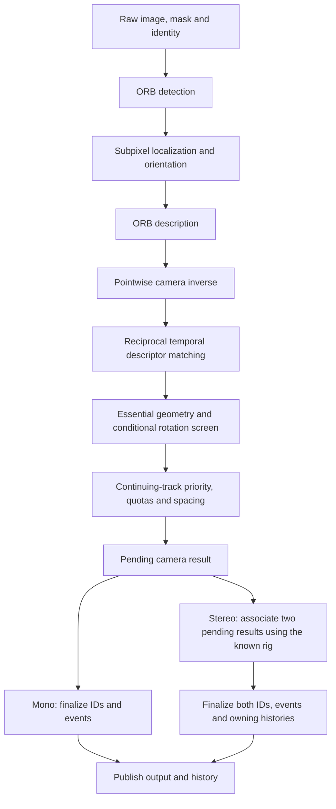

# Visual Frontend Architecture

**Status:** Draft; describes the implemented frontend, not estimator or deployment acceptance.

## Scope and requirements

The host frontend converts raw grayscale images into identified feature
observations. Its current ORB implementation supports one camera or a calibrated
stereo pair on CPU/CUDA. It detects features again in each image and associates
descriptors across images; it does not perform KLT patch tracking.

[V-ORB](../requirements/vision/orb-frontend.md) owns extraction/association,
[V-LOCALIZE](../requirements/vision/feature-localization.md) owns localization,
and [V-STEREO](../requirements/vision/stereo-association.md) owns optional stereo.
The [application architecture](application-composition.md) owns component assembly.
The [frontend profile](../profiles/orb-frontend.md) owns numerical settings and
library recipes; the [guide](../../guides/frontend.md) owns build/replay commands.

Triangulation, clone-bound observation storage, filter updates, mapping and
relocalization are outside this implemented pipeline. Frontend completion does
not establish an integrated MSCKF.

## Responsibilities and interfaces

| Owner | Responsibility and boundary |
|---|---|
| Acquisition adapter / V-ACQUISITION | Supply raw images/masks, integer acquisition time, camera/session/image IDs and calibration/noise bindings. Physical calibration and synchronization remain caller premises. |
| Camera inverse / M-UNPROJECT | Convert a raw pixel into a normalized ray using the shared radial-tangential forward model and bounded inverse. It has no OpenCV or tracking state. |
| Host tracker / V-EXECUTION, V-ORB | Own detector/descriptor buffers and preceding successful observations; publish an owning, method-neutral batch. |
| Stereo owner / V-STEREO | Prepare both camera results, associate selected observations with known rig geometry and allocate shared IDs before publishing either history. |
| Estimator observation owner / V-TRACK | Later bind observations to clone times, retain multi-frame history and prevent measurement reuse. Frontend events do not implement this store. |

The common [result](../../../include/formal_gvins/vision/tracker.hpp) contains
identity, pixel domain, observations and per-camera lifecycle events. Each
observation carries a track ID, raw pixel `(u,v)` and derived normalized ray
`(x,y,1)`. The ray is not unit length or an independent measurement. An ORB
descriptor is a separate appearance record, not a coordinate, landmark or ID.

`OrbTracker` provides `process` and `reset` without a virtual base class. Its
optional diagnostics own ORB-specific data and stage measurements. `StereoOrbTracker`
uses paired inputs/outputs and the same observation format. OpenCV types stay in
the host adapter; numerical consumers receive records under their own bounded
admission contract. See [V-EXECUTION](../requirements/vision/frontend-execution.md).

## Execution and state

Per-camera preparation follows this order:

The first image has no temporal association. A missing/invalid image fails;
a valid image with no admitted features succeeds with an empty set. Geometry
failure confirms no temporal continuations, but new observations may still be
published. Descriptor or geometry-backend exceptions instead fail that temporal
operation. The distinction follows V-EXECUTION and V-OBSERVATION.

Preparation does not mutate live history. Finalization allocates IDs/events and
owning history; publication moves the complete result only after fallible work
succeeds. Stereo completes both preparations and finalizations before committing
either camera. A rejected, unsynchronized or backend-failed stereo association
keeps valid mono results; an invalid camera input or temporal failure preserves
both old results. Numerical calibration is fixed at construction.

Each tracker is blocking and single-owner. CUDA performs detection, description
and Hamming search; localization, inversion, geometry and selection run on the
host. Host storage can allocate and allocation exceptions can propagate. There
is no implicit CPU fallback, asynchronous queue or deadline guarantee.

## Design decisions

### Camera inverse

The project implements Newton root finding in
[radtan.hpp](../../../include/formal_gvins/camera/radtan.hpp), not an OpenCV
`undistortPoints` call or a multi-observation least-squares fit. Let `D` be the
normalized distortion map, distinct from the complete pixel map `D_c` in M-VISUAL:

$$
z_d=\begin{bmatrix}(u-c_x)/f_x\\(v-c_y)/f_y\end{bmatrix},\qquad
J_D(\xi_k)\Delta_k=D(\xi_k)-z_d,\qquad
\xi_{k+1}=\xi_k-\Delta_k.
$$

Initialize `xi_0=z_d`. Each evaluation checks the domain, analytic Jacobian and
pixel-scaled forward residual; a nonaccepted iterate can take one checked Newton
step. The fixed evaluation cap includes residual checks. No step clamping,
line search or last-iterate success is used. The conservative positive-Jacobian
domain check is not an interval proof or a physical calibration certificate.
Shared forward algebra keeps projection and inverse conventions consistent.

### Localization and descriptor encoding

OpenCV `cornerSubPix` performs gradient-based local least-squares corner
refinement. The project calls one iteration at a time at the detected octave,
checking each returned location's support and displacement. It then checks
gradient quality and recomputes intensity-centroid orientation before description.
An unchanged point does not prove convergence: the library can stop or revert
internally without a per-point reason. Acceptance uses observable checks and
separate localization-error qualification under V-LOCALIZE.

OpenCV ORB with `WTA_K=2` uses a fixed pattern of 256 position pairs rotated by
the keypoint orientation. Each comparison on the smoothed pyramid image produces
`b_i=1` when the first intensity is lower than the second, otherwise `b_i=0`.
Eight bits pack into each byte, yielding 32 bytes per descriptor. Hamming distance
counts differing bits, in `[0,256]`; it is not pixel distance or a probability.
Sampling/rounding and CPU/CUDA compatibility are bound by the profile.

### Association and feature selection

OpenCV supplies two-nearest Hamming candidates in both directions. Project logic
requires both strict ratio tests and mutual best matches, then applies the
normalized essential/Sampson test from V-ORB. The additional rotation screen only
removes E inliers when its support conditions hold. It never rescues a failed E
fit, estimates usable depth, or asserts that physical translation is zero.
No IMU motion prior or KLT recovery is used.

Selection runs after temporal verification. Continuing tracks precede new points;
older tracks take priority, with stable-ID ties. New points use response/index
order. All points share cell quotas and a global raw-pixel spacing rule across
cells and octaves. Unused quotas are not redistributed. This preserves eligible
history within the budget; it cannot recover an old point absent from detection
or retain one that failed geometry. Stereo subsequently associates these selected
per-camera sets, without refilling or rerunning selection.

## Verification boundary

The [inventory](../../analysis/requirements-inventory.md#acquisition-and-visual-observations)
links contracts to production and test sources. Known rays, corners, descriptor
cases and 3D scenes test separate numerical/association properties. Lifecycle and
injected OpenCV failures test publication and history ownership. These checks do
not prove physical feature identity, calibration, noise or device-failure recovery.

Mono/stereo EuRoC replays exercise actual images. Known synthetic image transforms
supply correspondence labels for the benchmark; EuRoC pose truth alone cannot
score per-feature precision/recall. Completed track lifetimes and still-active
tracks are reported separately. Host stage timing and process RSS exclude GPU
VRAM and do not establish Orin deadlines. GPU detector candidates may vary across
runs, so exact independent-run ID equality is not the CUDA acceptance oracle.

Qualification work remains in [VINS-11.1](../../roadmap.md#deferred-optimization-and-local-vins-integration)
and [B-01](../../roadmap.md#b-01-per-module-unit-benchmarks): track persistence,
false matches, localization rejection/noise, resource cost and reviewed regression
limits. Parameter changes require new identified evidence; passing unit tests
does not approve the Draft profile or provide Lean/ESBMC coverage.
